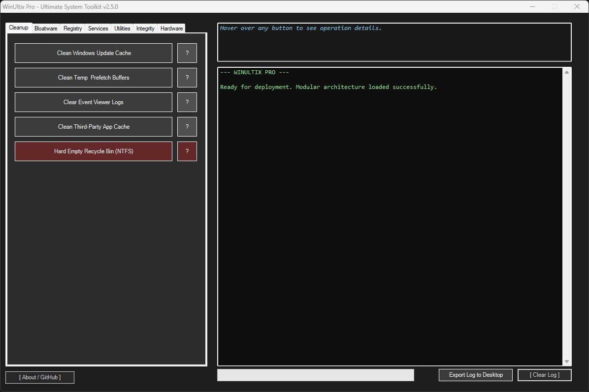
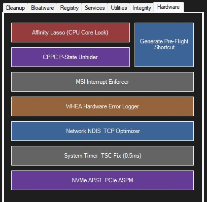
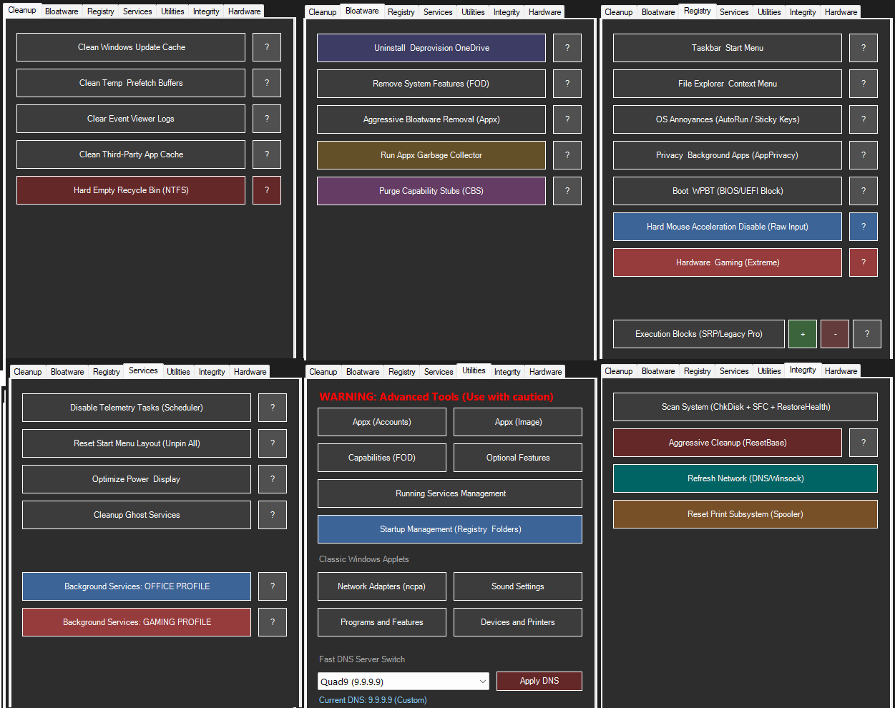

# WinUltix Pro 2.5 🚀
**An Advanced, Portable, Zero-Dependency Windows 11 Optimizer & Hardware Tuning Toolkit**

For years, I’ve been collecting various registry tweaks, optimization scripts, and diagnostics scattered across the internet. WinUltix was born to unify them. 

With version 2.5, the project has evolved from a simple debloater (135KB) into a massive, heavily engineered diagnostic suite (~250KB). It abandons legacy WMI functions in favor of modular encapsulation, direct kernel-level registry manipulation, and deep hardware inspection. 

Most "optimizers" on the market are black boxes that silently hijack OS privileges and break system integrity. WinUltix Pro is a **100% transparent, interactive, and fully reversible** toolkit that puts *you* in complete control of your OS, network stack, and hardware interrupts.

### 🛡️ Core Architecture & Philosophy
* **Modular Encapsulation:** The main `WinUltix_Pro.ps1` is now purely a UI launcher. All execution logic is safely sandboxed in isolated `Z1` to `Z7` modules.
* **Symmetric Revert Engine:** Complete peace of mind. Registry (Z3) and Service (Z4) modules now feature a unified `Show-ActionModal` allowing you to apply or symmetrically **revert** any setting back to Windows factory defaults.
* **Asynchronous Auditing:** Background Runspace threads and UI timers prevent the application from freezing during heavy file I/O operations (like deep Appx payload scans or WinSxS analysis).
* **Zero-Dependency & Portable:** A standalone, native PowerShell / WinForms application. No installations, no background telemetry.

---

### ⚙️ Feature Highlights (v2.5)

#### 1. Hardware & Latency Tuning (Z7 - NEW)
* **Affinity Lasso:** Automatically forces background applications (Discord, Browsers, Launchers) onto specific CPU cores (e.g., Cores 0-1) to dedicate prime threads to your games.
* **CPPC P-State Unhider:** Unlocks advanced AMD/Intel power states (EPP, Idle Demote/Promote) directly in the active Power Plan.
* **MSI Interrupt Enforcer:** Forces Message Signaled Interrupts (MSI) across the PCI bus to bypass IRQ sharing and drastically reduce DPC latency. Includes an automated registry backup mechanism.
* **WHEA Error Logger:** Parses system logs for hardware instability and decodes APIC IDs to pinpoint exactly which CPU core or RAM timing is failing (crucial for PBO/Curve Optimizer tuning).
* **Timer & NVMe Lock:** Directly injects `GlobalTimerResolutionRequests` to fix the Win11 0.5ms TSC API bug and disables PCIe ASPM/APST idle states to prevent NVMe micro-stuttering.
* **Pre-Flight Generator:** Creates a standalone macro-script on your desktop to instantly engage Affinity/CPPC locks before launching a game.

#### 2. Deep Bloatware & Junk Removal (Z1 & Z2)
* **Appx Garbage Collector:** Intelligently scans application dependency trees to find and eradicate orphaned UWP frameworks.
* **Copilot & CBS Amputation:** Uses aggressive `takeown` / `icacls` binary amputation for persistent bloatware and safely purges underlying CBS capability stubs.
* **Asynchronous Cleanup:** Weighs and purges Windows Update caches, Event Logs (via `wevtutil`), and Third-Party app caches (Discord, Edge, NVIDIA DxCache) across all user profiles simultaneously.

#### 3. Registry & Privacy Lockdown (Z3)
* **Software Restriction Policies (SRP):** Generates native OS-level execution locks (Safer API) to permanently block problematic executables (e.g., SearchHost, CrossDeviceResume) from ever running.
* **Raw Mouse Input:** Hard-disables pointer acceleration at the registry level (`MouseThreshold1/2`) for true 1:1 sensor tracking.
* **Extreme Gaming Profile:** Elevates gaming processes via Multimedia Class Scheduler (MMCSS) tweaks, disables VBS / Hypervisor Code Integrity, and disables Paging Executive to keep the kernel in RAM.

#### 4. Services & Integrity (Z4 & Z6)
* **Heavy/Light Service Profiles:** Pre-configured automated profiles to safely strip background services depending on whether the machine is an Office PC or a dedicated Gaming rig.
* **Ghost Service Sweeper:** Identifies and cleans registry entries for orphaned drivers and services pointing to non-existent binaries.
* **Print & Network Subsystem Resets:** Instantly fixes "No Internet" errors by flushing the network stack (Winsock) and repairs deadlocked print spoolers (purging stuck RAW/SHD files).
* **ResetBase (WinSxS):** Aggressively compresses the Component Store by destroying superseded Windows Update backups to reclaim massive amounts of C: drive space.

---

### 🚀 Getting Started

**No installation required.** 
1. Download `WinUltix_Pro_EN.exe` from the Releases tab.
2. Right-click -> **Run as Administrator** (UAC prompt will appear automatically).

### ⚖️ License
This project is licensed under the **MIT License**.

### ⚠️ Disclaimer
*Provided "AS IS". While WinUltix Pro strictly relies on documented OS policies, safe cache clearing, and built-in API hooks, low-level registry manipulation and hardware interrupt enforcement always carry inherent risks. Creating a system restore point before deployment is highly recommended.*

### ☕ Coffee
This project is, and always will be, free of charge. However, if you appreciate it, you can buy me a coffee. 
https://buymeacoffee.com/firever 
Thank you!