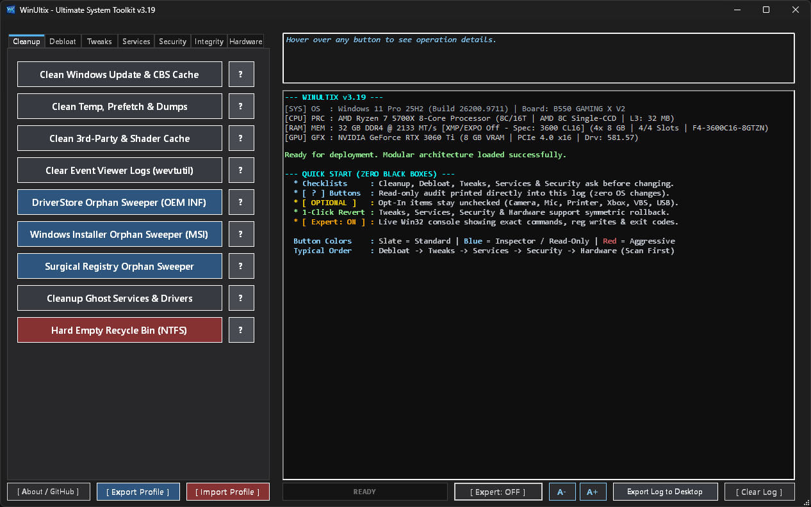
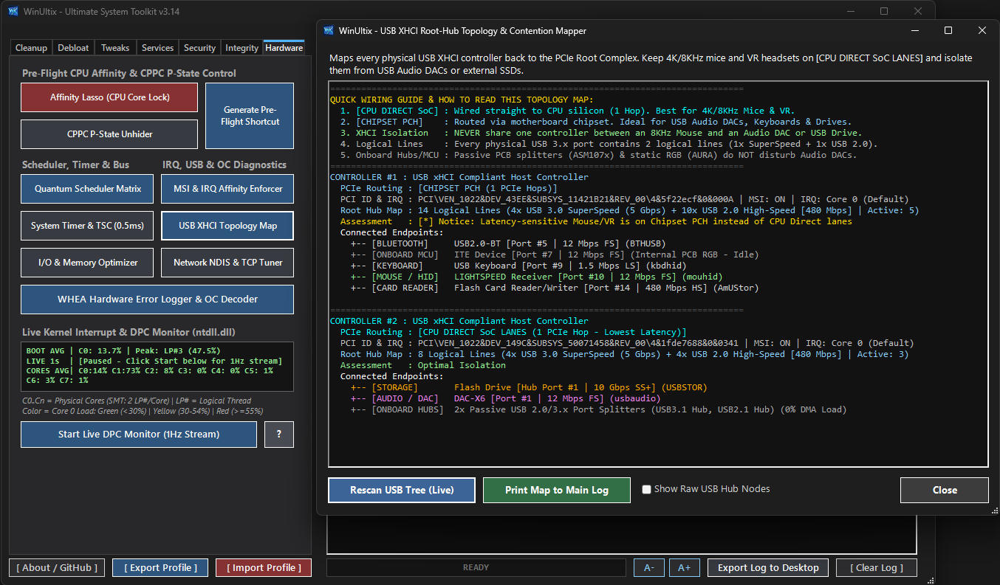
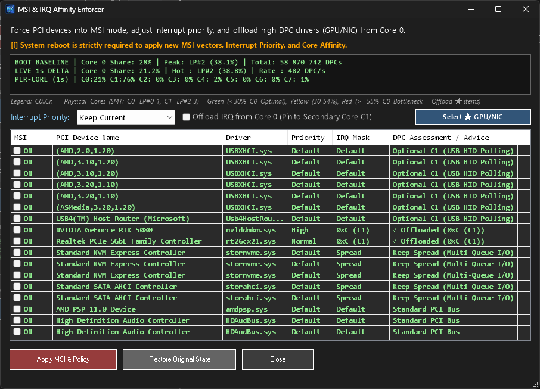
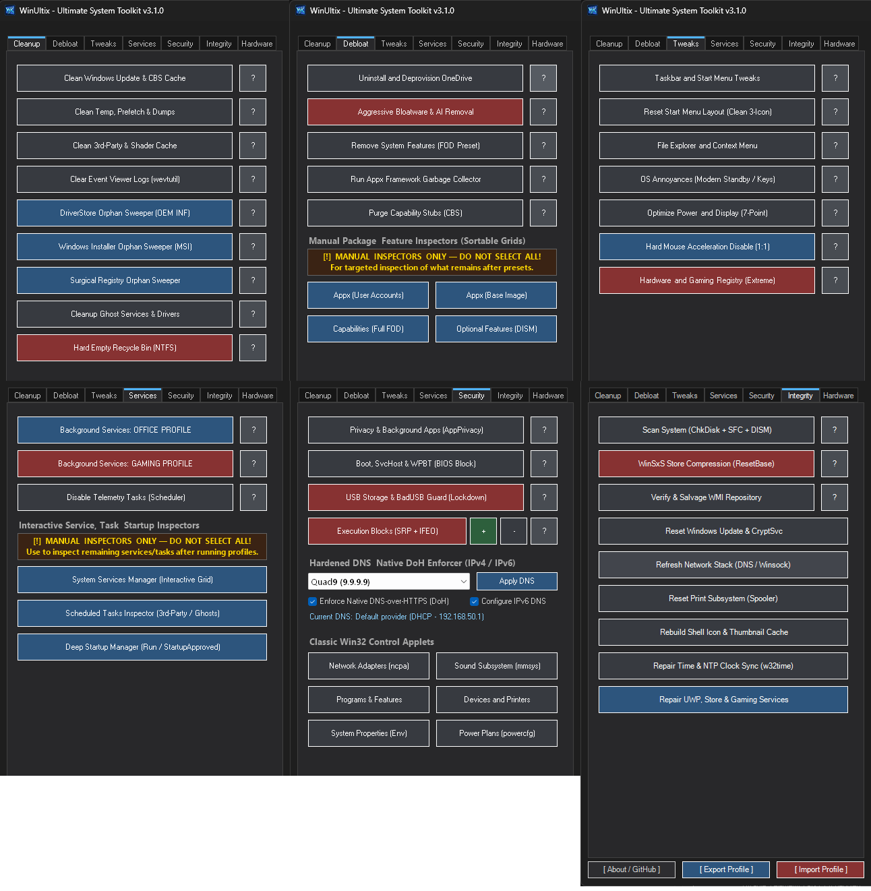
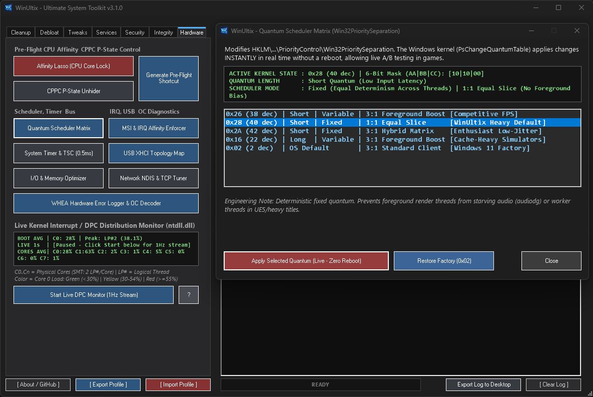

<div align="center">
  
  <h1>WinUltix 3.19</h1>
  <p><b>A ~800 KB Zero-WMI Windows 11 &amp; 10 Hardware Tuner, Debloater, and System First-Aid Toolkit</b></p>
</div>

> 🔗 **Part of the Ultix Ecosystem:**
> Clean, pre-debloated Windows 11 ISO deployment → **[AutoUltixed](https://github.com/Firever-ultix/AutoUltixed)**
> Live post-install hardware, kernel &amp; OS tuning → **[WinUltix](https://github.com/Firever-ultix/WinUltix)**

Most Windows utilities force a bad compromise: bloated 150 MB background apps that eat RAM, or reckless "black-box" scripts that break Windows Update and Xbox/Steam logins.

I built **WinUltix** to be the opposite: a **fast, 100% transparent, zero-dependency toolkit** for Windows 11 (24H2–26H2) and Windows 10. It replaces **10 standalone tools** (*DriverStore Explorer, PatchCleaner, MSI Utility, Process Lasso, LatencyMon, USB Tree Viewer, TimerResolution, Autoruns, TCP Optimizer, and Debloaters*) inside one dark native interface. Every tweak is explained on hover, runs asynchronously without freezing the UI, streams its exact commands to a **Live Expert Console**, and supports **1-click Revert**.



---

### ⚡ Quick Start

Run directly in memory from an **Administrator** PowerShell / Terminal window:

```powershell
irm https://raw.githubusercontent.com/Firever-ultix/WinUltix/main/build/WinUltix_Monolith.ps1 | iex
```

**Prefer a standalone executable?** Download `WinUltix.exe` (`796 KB`) from **[Releases](https://github.com/Firever-ultix/WinUltix/releases)**.
* **`WinUltix.exe` (v3.19) SHA-256:** `8009DF441BD9D885764FC0BC844744FD83B24FC33C3428A24F991C31EC30C587`

---

### 🔥 What Makes WinUltix Different

* **Zero Black Boxes (`[ Expert: OFF/ON ]` & Guided UX):** Opens with a built-in Quick Start legend and per-tab descriptions; every checklist and inspector modal supports live `Ctrl+F` filtering, color-coded status columns, untruncated row inspection (`Ctrl+C`), 2-click Revert (`Select Optimized`), and a live Win32 Expert Console showing exact commands and exit codes. A discreet `[Reboot Recommended]` title-bar tracker tracks pending kernel/BCD changes without nagging popups.
* **USB XHCI Topology &amp; Contention Mapper:** Maps every USB controller in the background so you can see which ports wire **directly to your CPU (SoC lanes)** vs. **Chipset (PCH)** bridges. Displays live port speeds (USB 2.0 / 3.0 / SS+ 10–20 Gbps / USB4), flags USB 3.x drives throttled to USB 2.0, deduplicates wireless dongles, and warns when a gaming mouse shares a controller with a USB DAC or external SSD.
* **Core 0 IRQ Offload + Live Kernel Driver Profiler:** Offloads GPU and NIC interrupts away from CPU Core 0 to stop audio crackles and 1% low drops, while profiling live ISR/DPC latency (`Avg µs/s`, `1s Load`, `Max Peak µs`) for both PCI drivers (`nvlddmkm.sys`, `amdkmdag.sys`, `USBXHCI.sys`) and OS subsystems (`dxgkrnl.sys`, `tcpip.sys`, `ntoskrnl.exe`).
* **Live Scheduler &amp; 0.5ms Timer Controls:** Switch `Win32PrioritySeparation` quantum presets live without rebooting, enforce TSC clock timing, and test global `0.5ms` timer precision in real time.
* **Instant `<1 ms` Hardware &amp; XMP/EXPO Banner:** Prints your OS build, motherboard, CPU/X3D CCD layout, GPU PCIe link (`PCIe 5.0 x16`), and raw RAM specs at startup—automatically warning you if a BIOS reset dropped XMP/EXPO back to JEDEC clocks.





---

### 🧰 7 Tabs, 64 Tools — At a Glance

Buttons are color-coded for fast scanning: **Slate** = Standard Action, **Steel Blue** = Interactive Inspector, **Crimson** = Aggressive / Lockdown, **Gray** = Audit. Risky daily-use tweaks (Mic, Camera, Printer, Xbox, Bluetooth, VBS/HVCI, USB locks) are marked `[ OPTIONAL ]` and **unchecked by default**.

#### 🧹 1. `Cleanup` (9 Tools)
* **Orphan Sweepers:** Purge superseded `oemXX.inf` drivers (DriverStore), dead `.msi`/`.msp` installer payloads, broken registry file paths (with JSON backup/restore), and ghost 3rd-party services—with critical OS, active hardware, and print drivers locked in red.
* **Cache &amp; System Cleaners:** Clean Windows Update/CBS, multi-profile Temp/Dumps, Browser/Discord/Steam/Spotify caches, **DirectX / NVIDIA / AMD shader caches**, Event Logs, and NTFS Recycle Bins.

#### 🗑️ 2. `Debloat` (9 Tools)
* **OneDrive &amp; 64 Bloatware Targets:** Multi-profile OneDrive removal (keeping `sfc /scannow` intact) and single-pass removal of 64 UWP apps, **Windows Recall**, and **Copilot AI**, while protecting Store, WinGet, Steam, and Xbox Gaming Services.
* **FOD, Stubs &amp; 4 Inspector Grids:** Strip unneeded Features on Demand (shielding active inbox Wi-Fi/Ethernet drivers), clean CBS stubs and orphaned UWP frameworks, or manually manage User Appx, Provisioned Appx, FODs, and Optional Features in searchable tables.

#### ⚡ 3. `Tweaks` (7 Tools)
* **Shell &amp; 26H2 Start Menu:** Left taskbar, clock seconds, classic context menu, no Bing search/Widgets (cleanly handling Windows 11 `UCPD.sys` locks), unpinned OneDrive, and a **1-click Clean 3-Icon Start Menu** with Classic Alphabetical All-Apps List and full backup/revert.
* **Power, Display &amp; Gaming:** Disable Hibernation, HDD sleep, **USB Selective Suspend** (stops DAC/8KHz mouse drops), and OLED/IPS CABC brightness shifting. Apply **live 1:1 Raw Mouse Input** without logging out, disable MPO/GameDVR, enable HAGS/Flip Model, and tune MMCSS/VBS.

#### ⚙️ 4. `Services` (6 Tools)
* **Reversible Profiles &amp; Telemetry Tasks:** Apply **Office (12 services)** or **Gaming (up to 60 services)** profiles (including Per-User sync templates) and disable 8 telemetry scheduled task branches—all 1-click reversible.
* **3 Interactive Managers:** Dark, searchable replacements for `services.msc` (with live `Start / Stop / Auto / Manual / Disabled` controls and `TrustedInstaller` unlock), Scheduled Tasks Inspector (flags broken `[GHOST]` tasks), and multi-profile Deep Startup Manager.

#### 🛡️ 5. `Security` (13 Tools)
* **4-Layer USB &amp; BadUSB Perimeter Guard:** Independently toggle USB/MTP Read-Only, USB `.exe` Execute-Deny, full USB storage blackout (`USBSTOR` + `UASPStor`), and Lock-Screen BadUSB/DMA protection.
* **Privacy, Kernel Locks &amp; Encrypted / Parental DNS:** 53 Privacy/AppPrivacy rules, UEFI WPBT block, SvcHost consolidation, dual-layer **`SRP + scoped IFEO`** execution locks (telemetry or custom `.exe` paths), **16 Hardened &amp; Parental Control DNS + Native DoH profiles** (Quad9, Cloudflare Standard/Security/Family, AdGuard Standard/Family, DNS4EU Protective/AdBlock/Child/Child+Ads, Control D Ads+Malware/Family, CleanBrowsing Family, OpenDNS Standard/FamilyShield, Google over IPv4/IPv6 with live hover specs), plus 8 classic Win32 Control Panel applets.

#### 🚑 6. `Integrity` (9 Tools)
* **OS Health &amp; WinSxS Compression:** Fast `<3s` `DISM /CheckHealth` + NTFS dirty-bit audit, automated `ChkDisk + DISM + SFC` repair console, and `DISM /ResetBase` to reclaim 5–15 GB of old update files.
* **1-Click First-Aid Suite:** Repair WMI Repository, Windows Update &amp; `CryptSvc`, Network Stack, Print Spooler, Shell Icon/Thumbnail Cache, NTP Clock Sync, and offline-resilient **Microsoft Store / WinGet / Xbox Gaming Services**.



#### 🔧 7. `Hardware` (11 Tools)
* **CPU Affinity Lasso &amp; Pre-Flight Mode:** Auto-detects **AMD 3D V-Cache** and **Intel Hybrid (P + E + LP-E)** CPUs to pin background apps away from gaming cores, unlocks hidden **CPPC P-States** with a boot-safe Dead Man's Switch, and creates a desktop **Pre-Flight Game Mode** toggle.
* **I/O, NIC &amp; WHEA OC Decoder:** Cleanly separated into reversible **Kernel/Bus Tuners** (with inline engineering notes &amp; reboot tags per setting for CPPC, Timer, NVMe, and NDIS/TCP) and **Read-Only Hardware Diagnostics** (USB XHCI Map, Live DPC, and **WHEA OC Decoder** mapping raw `APIC IDs` to physical cores with a built-in raw MCA Event Viewer log inspector).



---

### 💾 Portable Profiles &amp; Live Scaling

* **Export / Selective Import JSON Profiles:** Snapshot your active Registry tweaks, Start Menu clean state, DNS/DoH provider, Quantum Scheduler preset, Power/Display settings, USB Guard, SRP locks, Services, Hardware locks, and Affinity Lasso list—then inspect exact category contents and selectively pick what to apply in a 2-pane preview modal before importing.
* **Live Font Scaling (`[ A- ]` / `[ A+ ]`):** Adjust interface typography live on high-DPI displays without restarting.

---

<details>
<summary><b>🔬 Under the Hood: Architecture &amp; Win32 Internals (Click to Expand)</b></summary>

* **100% Zero-WMI, Locale-Independent &amp; AST-Compiled 7-Bit ASCII:** Replaces slow WMI/CIM calls and localized CLI parsing with direct `.NET` `Microsoft.Win32.Registry` access, binary `HKLM:\BCD00000000` timer inspection, well-known SIDs (`*S-1-5-32-544`), `GlobalMemoryStatusEx`, `QueryFullProcessImageNameW`, `FSCTL_IS_VOLUME_DIRTY`, `GetSystemFirmwareTable('RSMB')` (SMBIOS Type 17 SPD decoding), and native PowerShell AST (`Parser::ParseInput`) 7-bit ASCII compilation.
* **Native `CfgMgr32` &amp; USB IOCTL Probing:** Walks the PnP tree (`CM_Locate_DevNodeW`, `CM_Get_Parent`, `CM_Get_Child`, `CM_Get_DevNode_Status`) and queries `IOCTL_USB_GET_NODE_CONNECTION_INFORMATION_EX_V2` (`UsbSuperSpeedPlus`) and `DEVPKEY_Device_BusReportedDeviceDesc` directly from `USBHUB3.sys`.
* **Lock-Free Atomic Kernel ETW Profiler:** Runs a live `StartTraceW` / `ProcessTrace` session (`[WinUltix.DpcDriverProfiler]`) backed by immutable `Volatile` session snapshots, resolving ISR/DPC pointers against `NtQuerySystemInformation(SystemModuleInformation)` with atomic `Interlocked` counters.
* **Targeted Privilege &amp; Live SCM Escalation:** Acquires `SeTakeOwnershipPrivilege` / `SeRestorePrivilege` strictly on targeted `TrustedInstaller` registry keys and live SCM service object DACLs (`SetServiceObjectSecurity`) without token impersonation, updates live `services.exe` state via `ChangeServiceConfigW`, and symmetrically disarms Windows 11 `UCPD.sys` protection when toggling Widgets/Bing search.
* **Native Start Menu Compiler &amp; Scoped IFEO:** Rebuilds `start2.bin` via COM `IApplicationActivationManager` (`[WinUltix.AppActivator]`) and pairs Safer API policies with per-path `FilterFullPath` (`UseFilter = 1`) IFEO kernel filters.

</details>

---

### 🛡️ Antivirus False Positives &amp; Transparency

Because WinUltix is unsigned, requests Administrator rights, and modifies kernel registry keys, hardware power states, and OS services, heuristic antivirus engines may flag the `.exe`:
* **100% Open Source:** Every line is readable in `/src/Modules`. You can audit the source, run directly from memory (`irm ... | iex`), inspect every executed command live with **`[ Expert: ON ]`**, or compile your own `.exe` using `Compile-WinUltix.ps1` (includes automatic post-build `MpCmdRun.exe` verification).

---

### ⚖️ License &amp; Support

* Licensed under the **MIT License** (*provided "AS IS"—creating a System Restore Point before heavy OS/hardware changes is recommended*).
* WinUltix is—and will always be—100% free, open-source, and ad-free. If it saved you time or smoothed out your frametimes, you can buy me a coffee:

👉 **[https://buymeacoffee.com/firever](https://buymeacoffee.com/firever)**