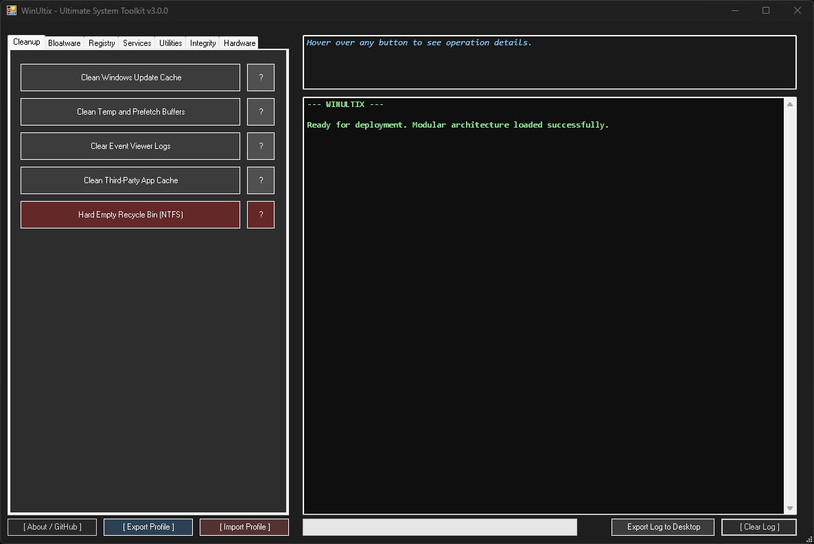
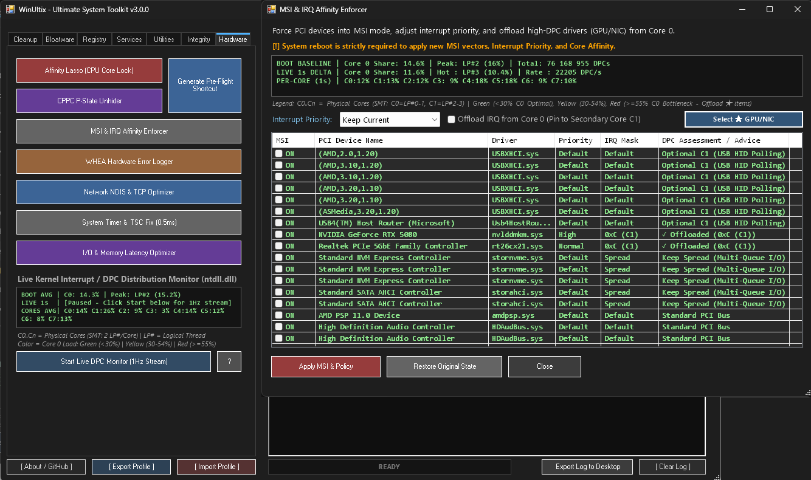
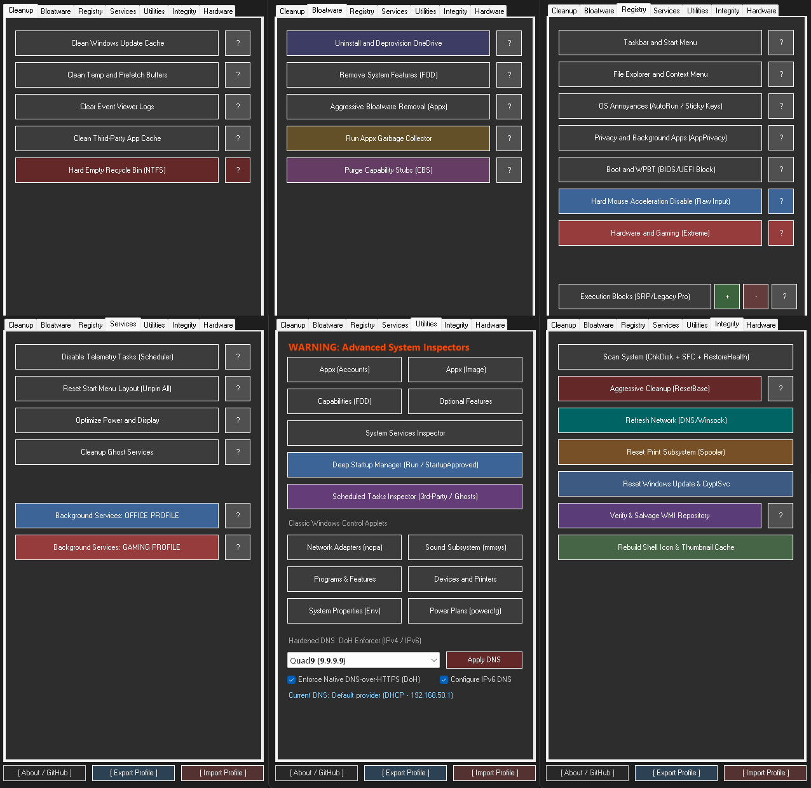

> 🔗 **Part of the Ultix Ecosystem:**
> Looking for a clean, pre-debloated Windows 11 ISO deployment? Check out **[AutoUltixed](https://github.com/Firever-ultix/AutoUltixed)**.
> Looking for live post-install hardware, kernel & OS tuning? You are at **[WinUltix](https://github.com/Firever-ultix/WinUltix)**.

# WinUltix 3.0 🚀
**An Advanced, Portable, Zero-Dependency Windows 11 (24H2 / 25H2 / 26H2) & Windows 10 Kernel, Hardware & OS Optimization Toolkit**

For years, I’ve been collecting registry tweaks, low-level hardware tuning scripts, and system repair routines scattered across the internet. **WinUltix** was born to unify them under a single, uncompromising engineering standard—packaged into a standalone ~500 KB toolkit with zero external dependencies.

With **version 3.0**, the project has completed a full architectural transformation into a multithreaded, kernel-aware diagnostic and low-level tuning suite across 9 modular files. I completely eliminated legacy WMI calls, `wmic.exe` dependencies, `Application.DoEvents()` loops, and external white `Out-GridView` windows in favor of a unified C# P/Invoke runtime (`ntdll.dll`, `kernel32.dll`, `dwmapi.dll`, `advapi32.dll`, `user32.dll`), isolated multithreaded Runspaces with real-time `$UltixSync` telemetry streaming, native dark double-buffered WinForms grids, and portable JSON configuration snapshots.

Most "optimizers" on the market are bloated Electron wrappers or black boxes that silently hijack OS privileges and break system integrity. WinUltix is a **100% transparent, interactive, and symmetrically reversible** toolkit that puts *you* in complete control of your OS, service DACLs, network stack, and hardware interrupts.



---

### 🔥 Top QoL & Engineering Gems (At a Glance)
WinUltix bridges the gap between everyday Windows administration QoL (fixing decades-old annoyances in Microsoft's built-in `services.msc` and Task Manager) and hardcore kernel/hardware tuning:

* **Instant Live-Search System Inspectors (Z5):** Built-in `services.msc` still lacks a search bar after 25 years. WinUltix gives you a dark, sortable, instant-filter **Services Manager** that displays the entire service table, shields critical OS/RPC/Defender services in red (`[CRITICAL - LOCKED]`), and automatically escalates `TrustedInstaller` tokens when disabling stubborn services.
* **High-Signal Scheduled Tasks & Deep Startup Decoders (Z5):** Filters out ~180 noisy internal Windows tasks to immediately expose **3rd-Party Updaters**, **MS Telemetry**, and **`[GHOST / Missing Exe]`** tasks. The Startup Manager decodes Task Manager’s undocumented binary `StartupApproved` headers and `FILETIME` timestamps across `Run`, `RunOnce`, and `GPO` keys.
* **Live 1Hz Kernel DPC Monitor & Smart Core 0 IRQ Offload (Z7):** Queries `ntdll.dll!NtQuerySystemInformation` in real time to map DPC/interrupt load across physical CPU cores (`C0..Cn`). Automatically flags heavy GPU (`nvlddmkm.sys`/`amdkmdag.sys`) and Network NDIS drivers choking `Core 0` (`★ OFFLOAD TO C1`) inside a 6-column sortable PCI grid.
* **2Hz Hardware Timer Resolution + Live `0.5ms` Test Pulse (Z7):** Unlocks global `0.5ms` timer propagation in Windows 11, forces CPU `TSC` in BCD, and includes a live **`Test 0.5ms Lock`** button (`NtSetTimerResolution`) so you can verify sub-millisecond clock behavior on the fly.
* **One-Click Subsystem First-Aid (Z6):** Dedicated background repair engines that fix deadlocked Print Spooler queues (`.SPL`/`.SHD`), broken Windows Update & Cryptographic stores (`catroot2`, `qmgr*.dat`, 31 COM DLLs), corrupted WMI/CIM repositories (`winmgmt /salvagerepository`), and blank Explorer icons (`iconcache_*.db`).
* **Interactive 8-Point Power & OLED/Display Tuner (Z4):** Fine-tune Hibernation (`hiberfil.sys`), Sleep/Monitor timeouts, SATA AHCI spin-down, **USB Selective Suspend** (protecting external audio DACs, VR headsets, and 4K/8KHz wireless dongles), PCIe ASPM, and **Content Adaptive Brightness (CABC / OLED auto-dimming)** with full symmetric revert.

---

### 🛡️ Core Architecture & Engineering Philosophy (v3.0)
* **Unified C# P/Invoke Runtime (`Core_Helpers.ps1`):** Compiles a single, zero-dependency C# interop layer into the `AppDomain` covering DWM Immersive Dark Mode (`DwmSetWindowAttribute`), High-DPI GDI Scaling (`SetProcessDpiAwarenessContext`), live Win32 shell broadcasts (`SHChangeNotify` / `WM_SETTINGCHANGE`), token privilege escalation (`AdjustTokenPrivileges`), COM `IApplicationActivationManager`, native CPU/L3 Cache topology (`GetLogicalProcessorInformationEx`), and `ntdll.dll` kernel timer & interrupt telemetry (`NtQueryTimerResolution` / `NtSetTimerResolution` / `NtQuerySystemInformation`). Includes custom owner-drawn GDI+ controls (`[WinUltix.DarkTabControl]` with `TCM_ADJUSTRECT` border removal and `[WinUltix.DarkProgressBar]` with live percentage readout) paired with a syntax-highlighted `RichTextBox` diagnostic terminal.
* **Real-Time Streamed Runspace Engine (`Invoke-AsyncTask` & `$UltixSync`):** Heavy I/O, COM, and servicing operations—including `.NET` stack directory sizing, transitive Appx dependency resolution, `DISM /AnalyzeComponentStore` progress streaming, Task Scheduler audits, NDIS adapter resets, and WHEA XML log decoding—execute inside isolated background Runspaces pre-hydrated via `InitialSessionState` and polled by non-blocking 150ms UI timers.
* **Symmetric Revert Engine & TrustedInstaller Escalation:** Registry (`Z3`), Service (`Z4`), Power & Display (`Z4`), Scheduled Task (`Z4`/`Z5`), Network NDIS (`Z7`), and IRQ/MSI (`Z7`) modules support bidirectional state control (`Apply` vs. `Revert`). Includes `DELETE_KEY` and `DELETE_VALUE` tokens that strip residual GPO policy banners and automatic `SeTakeOwnershipPrivilege` / `SeRestorePrivilege` token escalation to cleanly configure DACL-protected services (`WaaSMedicSvc`, `DoSvc`, `WSAIFabricSvc`).
* **Portable JSON Profile Snapshot Engine:** Export and import your active Registry tweaks, custom SRP+IFEO execution locks, disabled Services, Telemetry Tasks, Affinity Lasso roster, and low-level Hardware Locks (`WinUltix_Snapshot_v1`) across machines in one click.

---

### ⚙️ Module-by-Module Breakdown (v3.0)



#### 1. Hardware, IRQ Affinity & Kernel Latency Tuning (Z7)
* **Native P/Invoke Topology-Aware Affinity Lasso:** Queries `kernel32.dll!GetLogicalProcessorInformationEx` (`[WinUltix.CpuTopology]`) to inspect physical core masks, `EfficiencyClass` flags, and L3 Cache domains. Automatically locks background bloat (Discord, Browsers, Launchers, Overlays) with `BelowNormal` priority to Cores 0–1 on AMD 8-Core Single-CCD chips (e.g., 9800X3D/7800X3D), the non-3D V-Cache CCD tail on asymmetric AMD Dual-CCD CPUs (7950X3D/9950X3D), or the exact E-Core cluster on Intel Hybrid architectures.
* **6-Column Sortable MSI Enforcer & Core 0 IRQ Offload:** Scans PCI enumeration trees (`Service`, `Class`, `Interrupt Management`) and presents every MSI-capable device in a sortable 6-column `ListView` (`MSI`, `PCI Device Name`, `Driver`, `Priority`, `IRQ Mask`, `DPC Assessment`). Automatically flags high-DPC drivers sitting on `Core 0` (`★ OFFLOAD TO C1` for GPU `nvlddmkm.sys`/`amdkmdag.sys` and NIC drivers, `Optional C1` for USB XHCI/USB4 controllers, and `Keep Spread` protection for multi-queue NVMe/AHCI storage). Features a one-click **`Select ★ GPU/NIC`** button and a URL-safe Base64 registry backup for instant factory restoration.
* **3-Line Live Kernel DPC & Per-Core Distribution Monitor (`ntdll.dll`):** Queries `NtQuerySystemInformation` (`SystemInterruptInformation`, class `0x17`) at 1Hz both on the main `Hardware` tab (with auto-pause when switching tabs) and inside the MSI modal. Displays persistent **Boot Baseline** stats, **Live 1s Delta** (`Core 0 Share %`, `DPC/s` rate, and hottest logical thread `LP#X`), and a real-time **Per-Core Map (`C0..Cn`)** across all physical CPU cores, paired with a `?` diagnostic report generator.
* **CPPC P-State Unhider & SYSTEM Dead Man's Switch:** Unlocks hidden processor power attributes (`EPP`, `Idle Demote`, `Idle Promote`) using a locale-independent hex parser. Engaging Max CPPC (`EPP 0%`, `Demote/Promote 100%`) archives factory values to `HKLM:\SOFTWARE\WinUltix\CPPC` and arms a `NT AUTHORITY\SYSTEM` Scheduled Task (`AtStartup` + `AtLogon`) to guarantee automatic rollback if an unstable undervolt causes a reboot.
* **Symmetric Asynchronous NDIS & TCP Optimizer:** Audits physical network adapters in a background Runspace without freezing the UI. Disables Interrupt Moderation, Flow Control, EEE/Green Ethernet power saving, and RSC/LSO offloads while enforcing `TCPNoDelay` and `TcpAckFrequency`—complete with per-interface backup (`HKLM:\SOFTWARE\WinUltix\Network_Backup`) for one-click factory restoration.
* **Asynchronous WHEA XML Decoder:** Parses `Microsoft-Windows-WHEA-Logger` XML payloads in a background thread, translating raw `APICId` / `ProcessorId` values into physical CPU cores (SMT-aware) to pinpoint unstable PBO/Curve Optimizer cores (Event ID 18), FCLK/SoC errors (ID 19), or unstable DDR5 memory timings (ID 47).
* **Live 2Hz Kernel Timer (0.5ms TSC + Test Pulse), NVMe APST & Pre-Flight Macro:** Streams real-time clock resolution at 2Hz via `ntdll.dll!NtQueryTimerResolution`, features a live **`Test 0.5ms Lock`** toggle (`NtSetTimerResolution`), injects `GlobalTimerResolutionRequests = 1`, locks CPU TSC in BCD (`disabledynamictick yes`, `useplatformclock no`), disables PCIe ASPM (`pci.sys`), StorNVMe APST (`stornvme.sys`), and RAM compression (`MMAgent`), and generates a dark-themed, High-DPI desktop `Pre-Flight Game Mode` macro with live `ENGAGED [ARMED]` / `RELEASED [STANDBY]` status detection.

#### 2. Deep Bloatware, Recall Lockdown, OneDrive & High-Speed Junk Removal (Z1 & Z2)
* **High-Speed .NET Cache & Log Sweeper (Z1):** Uses a stack-based `.NET` directory enumerator (`Get-UltixFastSize`) injected into background Runspaces to weigh and purge gigabytes of data in milliseconds without `PSObject` allocation overhead or NTFS `ReparsePoint` loops. Asynchronously clears Windows Update, Delivery Optimization, and CBS Servicing logs (preserving initial `wuauserv`/`bits`/`dosvc` service states via `try/finally`), Windows Error Reporting (WER) queues, crash dumps, Event Viewer channels (`wevtutil`), NTFS Recycle Bins, GPU shader caches (`D3DSCache`, NVIDIA `DXCache`/`GLCache`, AMD `DxCache`), and multi-profile browser caches (`Default` + `Profile *` across Chrome, Edge, Brave, Vivaldi, Firefox, and Opera).
* **Granular 64-Target 26H2 Bloatware Catalog & Windows Recall Amputation (Z2):** Scans 64 non-overlapping UWP bloatware targets—including Windows Recall (`Disable-WindowsOptionalFeature -Online -FeatureName "Recall" -Remove` + `DisableAIDataAnalysis` / `TurnOffSavingSnapshots` GPO locks), Copilot, DevHome, New Outlook, MSTeams, Edge Game Assist, Clipchamp, Widgets, and individually selectable third-party apps (Spotify, TikTok, Netflix, King/Playrix games, and OEM trialware). Automatically locks `AppxAllUserStore\Deprovisioned` so Windows Update never reinstalls purged packages.
* **Transitive Appx Garbage Collector:** Computes full transitive dependency closures (`App -> Framework -> Nested Framework`) in a background Runspace to eradicate orphaned UWP frameworks and base-image payloads while strictly protecting critical gaming, codec, and shell runtimes (`XboxIdentityProvider`, `XboxGameCallableUI`, `VCLibs`, `.NET`, `UI.Xaml`, `WindowsAppRuntime`, `WindowsAppSDK`, `DirectX`, `Graphics.Canvas`, `AIFabric`, `AugLoop`, `MicrosoftWindows.Client.*`).
* **Multi-Profile SFC-Safe OneDrive Amputation with DLL Evacuation:** Dynamically maps all user profiles and loaded `HKEY_USERS\<SID>` registry hives via `Get-UltixUserProfiles` (zero hardcoded `C:\Users` paths) to purge OneDrive payloads, startup hooks, and zombie registry keys while keeping dormant `%SystemRoot%` stubs intact for DISM/SFC integrity. Automatically evacuates memory-mapped shell extensions (`FileSyncShell64.dll`) locked by `explorer.exe` to `%TEMP%` for clean folder eradication.

#### 3. Registry, Dual-Layer SRP+IFEO & Privacy Lockdown (Z3)
* **Handle-Cached Registry Audit & Live Shell Refresh:** Audits 90+ kernel, UI, and policy keys in milliseconds using cached `.NET` registry handles that distinguish uninitialized `(Default)` keys from empty string overrides (`InprocServer32`). Applies Taskbar and Explorer modifications live via Win32 `SHChangeNotify` and `WM_SETTINGCHANGE` broadcasts without killing open File Explorer windows.
* **Dual-Layer Execution Locks (Safer API + Scoped Kernel IFEO):** Combines deterministic MD5-hashed Software Restriction Policies (Safer API) with kernel-level `Image File Execution Options` (`IFEO`) debugger hooks (`Debugger = "systray.exe"`) to permanently block persistent OS binaries (`Widgets.exe`, `CompatTelRunner.exe`, `DeviceCensus.exe`, `GameBarPresenceWriter.exe`, `MicrosoftEdgeUpdate.exe`). Custom `.exe` targets automatically leverage native NT kernel path filtering (`UseFilter = 1` + `FilterFullPath`) to avoid blocking unrelated executables sharing the same filename.
* **Clean GPO Privacy & WNS Push Lockdown:** Blocks UWP background permissions (`AppPrivacy`, Camera, Microphone), machine-wide WNS cloud push notifications (`NoCloudApplicationNotification`), Content Delivery Manager silent installs, and WPBT BIOS/UEFI binary injections—symmetrically deleting policy values (`DELETE_VALUE`) on revert so Windows Settings never displays residual *"Some settings are managed by your organization"* banners.
* **Raw Mouse Input, MPO Control & Extreme Gaming Profile:** Hard-disables pointer acceleration (`MouseSpeed`, `MouseThreshold1/2`) for 1:1 sensor tracking, disables DWM Multiplane Overlay (`OverlayTestMode = 5`) to eliminate VRR/OLED flickering, enforces DirectX Flip Model optimizations (`SwapEffectUpgradeEnable=1;`), dynamically scales `SvcHostSplitThresholdInKB` to physical RAM, eliminates Explorer startup delay (`StartupDelayInMSec = 0`), and elevates game threads via `MMCSS` (`SystemResponsiveness = 0`, `GPU Priority = 8`).

#### 4. Services, Power & Display Tuner, Native Start Menu Compiler & Subsystem First-Aid (Z4 & Z6)
* **TrustedInstaller-Aware Service Profiles (51 Targets):** Pre-configured, symmetrically reversible **Office (Light)** and **Gaming (Heavy)** profiles that strip background telemetry, SRUM disk I/O logging (`DPS`, `WdiServiceHost`, `WdiSystemHost`), NTFS link tracking (`TrkWks`), legacy UPnP/SSDP/NetBIOS broadcasts, and AI background services in an asynchronous Runspace. Automatically escalates process token privileges (`SeTakeOwnershipPrivilege` / `SeRestorePrivilege`) to unlock DACL-protected services like `WaaSMedicSvc`, `DoSvc`, and `WSAIFabricSvc`.
* **Interactive 8-Point Power & Display Optimizer (Z4):** Symmetrically reversible modal auditing System Hibernation (`hiberfil.sys`), Standby/Monitor timeouts, HDD/SATA AHCI controller spin-down, USB Selective Suspend, Power Plan PCIe ASPM, 100% Minimum Processor AC state, and Display Content Adaptive Brightness Control (`CABC` / OLED auto-dimming).
* **Deterministic Start Menu Reset (24H2–26H2 Native Compiler):** Temporarily registers a local MDM `PolicyManager` context (`ConfigureStartPins`), purges `CloudStore` tile caches, and activates `StartMenuExperienceHost.exe` via COM (`IApplicationActivationManager`) with real-time `$UltixSync` progress streaming to compile a clean, build-native `start2.bin` (**Edge, Settings, File Explorer**) before stripping all MDM locks.
* **Precision Ghost Service & Driver Sweeper:** Asynchronously audits `HKLM:\SYSTEM\CurrentControlSet\Services` against live Win32 services and kernel drivers (`Win32_SystemDriver`), normalizing kernel root prefixes (`\SystemRoot\`, `System32\`) while masking out `0x40` per-user UWP service templates to eradicate orphaned entries with zero false positives.
* **Real-Time Streamed CBS/WinSxS ResetBase & Subsystem First-Aid (Z6):** Streams live `DISM /AnalyzeComponentStore` progress directly to the GUI without blocking, checks for `RebootPending` locks to prevent `0x800f0806` errors prior to `DISM /ResetBase`, and latches true `HRESULT` exit codes (`cmd /v:on`) across multi-stage `chkdsk`/`dism`/`sfc` repairs. Includes dedicated asynchronous First-Aid engines to reset deadlocked Print Spooler queues (`.SPL`/`.SHD`), rebuild broken Windows Update & Cryptographic subsystems (`catroot2`, `DataStore`, `qmgr*.dat`, and 31 COM DLLs), verify and non-destructively salvage corrupted WMI/CIM repositories (`winmgmt /salvagerepository`), and purge corrupted Explorer `iconcache_*.db` / `thumbcache_*.db` databases.

#### 5. Asynchronous System Inspectors, Classic Applets & Native DoH DNS Enforcer (Z5)
* **Native Dark `ListView` Inspectors (Zero `Out-GridView`):** Selectively audit and purge installed Appx packages (with automatic `Deprovisioned` store locking), provisioned base-image payloads, Features on Demand (FOD), Optional Features, and System Services (with visible, red-locked `[CRITICAL - LOCKED]` boot/RPC/Defender services) inside a double-buffered dark WinForms grid (`Show-UltixGridModal`) featuring live search filtering and column sorting.
* **Scheduled Tasks Inspector (3rd-Party, Bloat & Ghosts):** Cuts through ~180 internal Windows servicing tasks to expose only third-party background updaters, Microsoft telemetry/bloat, and orphaned `[GHOST / Missing Exe]` tasks pointing to deleted binaries, with support for either permanent unregistration or non-destructive state toggling.
* **Deep Startup Manager (`StartupApproved` Binary Decoder):** Audits `Run`, `RunOnce`, `Policies\Explorer\Run` (x64 and `WOW6432Node` x86), and Startup folders while decoding Task Manager's `StartupApproved` binary headers and UTC `FILETIME` timestamps—allowing you to either permanently delete autorun entries or toggle their enabled/disabled state in place.
* **Direct Win32 Control Panel Applets:** One-click bypasses for Windows 11 Settings redirects—opening classic `ncpa.cpl`, `mmsys.cpl`, `appwiz.cpl`, `SystemPropertiesAdvanced.exe`, `powercfg.cpl`, and the full `Devices and Printers` Control Panel frame (complete with the native *Add a printer / Print server properties* command bar).
* **Dual-Stack IPv4/IPv6 & Native DoH DNS Enforcer:** Switches active network interfaces between hardened DNS providers (Quad9, Cloudflare, AdGuard, Google, OpenDNS) and DHCP across both IPv4 and IPv6 stacks while directly injecting `DohFlags` into the kernel `Dnscache` (`DohWellKnownServers` & `InterfaceSpecificParameters`) to enforce native Windows 11 DNS-over-HTTPS encryption.



---

### 🛡️ Antivirus Detections & Transparency (False Positives)
Because WinUltix modifies low-level kernel registry keys, escalates service DACL tokens, adjusts hardware power states, and disables OS telemetry services, some aggressive machine-learning (ML) engines may flag the compiled executable:
* **Why does this happen?** The binary is unsigned and requires Administrator privileges to access `HKLM`, `ntdll.dll`, and SCM hardware subsystems.
* **100% Transparent:** The complete source code is open and verifiable. You can inspect every module in `/src` or build the standalone executable yourself using `Compile-WinUltix.ps1`.
* **Zero-Download Alternative:** If you prefer not to run compiled binaries, run the verified source script directly in memory via PowerShell.

### 🚀 Getting Started

WinUltix offers two deployment methods:

#### Option 1: Instant Launch (Recommended — Zero Download)
Run the latest verified build directly in memory with Administrator privileges:
```powershell
irm https://raw.githubusercontent.com/Firever-ultix/WinUltix/main/build/WinUltix_Monolith.ps1 | iex
```

#### Option 2: Standalone Executable

1. Download `WinUltix.exe` from the **[Releases](https://www.google.com/search?q=https://github.com/Firever-ultix/WinUltix/releases)** tab.
2. Right-click -> **Run as Administrator** (UAC prompt will appear automatically).
`WinUltix.exe` SHA-256: F946C65BE7872C8D366E305076EF0020CEA92268C67A6392CA501AFAB24F44A8

### ⚖️ License

This project is licensed under the **MIT License**.

### ⚠️ Disclaimer

*Provided "AS IS". While WinUltix strictly relies on documented OS policies, safe cache clearing, and built-in API hooks, low-level registry manipulation and hardware interrupt enforcement always carry inherent risks. Creating a system restore point or exporting a WinUltix JSON Profile before deployment is highly recommended.*

### ☕ Coffee

This project is, and always will be, free of charge. However, if you appreciate my engineering work, you can buy me a coffee:

https://buymeacoffee.com/firever

Thank you!