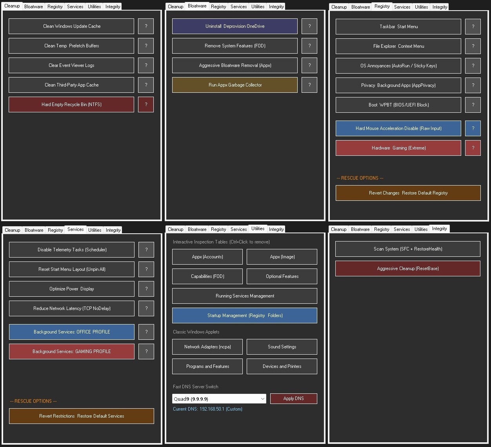

# WinUltix Pro 🚀
**A 200KB, Zero-Dependency, Diagnostic Windows 11 Optimizer**

Most "debloaters" on the market are black boxes. They force you to click a magic button, silently hijack OS privileges, and leave you guessing what actually changed when your system becomes unstable.

**WinUltix Pro** takes an engineering approach. Built for IT professionals, hardware enthusiasts, and gamers who need to squeeze maximum performance out of high-end setups. It surgically removes telemetry, bloatware, and background noise—while acting as a **full diagnostic toolkit** that is **100% transparent and fully reversible.**

### 🛡️ Core Philosophy
* **Diagnostic First (No Black Boxes):** Featuring an onboard interactive **Diagnostic Audit** module. Before making any changes, WinUltix calculates wasted MBs in caches, scans your registry for exact telemetry keys, and lists active bloatware. You always know *what* will be changed.
* **100% Reversible:** The built-in **Rescue Module** symmetrically reverts every single registry tweak, taskbar modification, and service state back to Windows defaults. 
* **Monolithic Architecture:** No Electron, no web-views, no background telemetry. Written in pure PowerShell / C# (WinForms) and compiled into a single, standalone **200KB `.exe`** executable.

---

### ⚙️ Feature Highlights

#### 1. Advanced Telemetry & Privacy Decimation
* **Task Scheduler Purge:** Safely disables Customer Experience tasks, Windows Error Reporting, and AI Feedback loops.
* **PowerShell & Defender Telemetry Block:** Injects machine-level variables to stop Microsoft from collecting background samples.
* **Hard MDM Policies:** Leverages enterprise-grade `ContentDeliveryManager` keys to permanently block Windows 11 from silently downloading promoted store apps.

#### 2. Deep Bloatware Removal & Smart Garbage Collection
* **Aggressive Appx Cleansing:** Uninstalls and *deprovisions* consumer bloatware (TikTok, Xbox Game Bar, Copilot) without breaking core UI.
* **Intelligent Garbage Collector:** Scans dependency trees and automatically removes orphaned UWP frameworks left behind by old apps.
* **OneDrive Eradication:** Kills the process, uninstalls the root binary, and forcefully removes leftover directories across all user profiles.

#### 3. Hardware & Gaming Profile 
* **Raw Input Enforcement:** Hard-disables mouse pointer acceleration (Enhance Pointer Precision) at the registry level for true 1:1 sensor tracking.
* **Network Latency Reduction:** Injects `TCPNoDelay` into active network adapters to prevent packet queuing in competitive gaming.
* **Priority MMCSS Tuning:** Forces SystemResponsiveness limits to 0% and elevates gaming processes via Multimedia Class Scheduler tweaks.

#### 4. Interactive Utilities & Layout Fixes
* **Start Menu Reset:** Safely wipes the internal `start2.bin` database, clearing all locked/bloated tiles for a fresh, fully customizable layout.
* **Interactive Grids:** Features GUI tables (`Out-GridView`) to selectively remove startup entries, deprovision Windows Capabilities (FOD), or hard-disable running services.
* **Fast DNS Switch:** Rapidly apply secure DNS providers (Cloudflare, Quad9, AdGuard) with a single click.

### 🚀 Getting Started

**No installation required.** 
1. Download `WinUltix_Pro_EN.exe` from the Releases tab.
2. Right-click -> **Run as Administrator** (UAC prompt will appear automatically).
3. We highly recommend running the **Diagnostic Audits** (`?` buttons) to analyze your current system state before applying any optimizations.

### ⚖️ License
This project is licensed under the **MIT License**.

### ⚠️ Disclaimer
*Provided "AS IS". While WinUltix Pro uses safe MDM policies, cache clearing, and standard service configurations rather than destructive file-deletion hacks, registry manipulation always carries inherent risks. Creating a system restore point before deployment is highly recommended.*

### Coffee
project is, and will be, free of charge. Instead, if you like it, you can buy me a coffee. 
https://buymeacoffee.com/firever 
Thank you!
