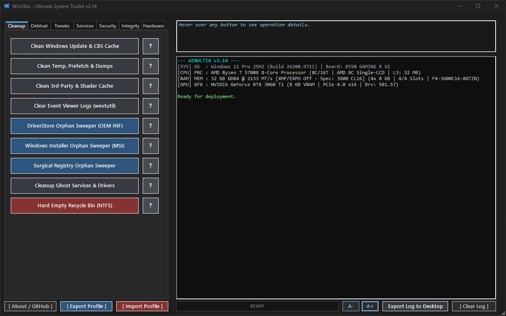
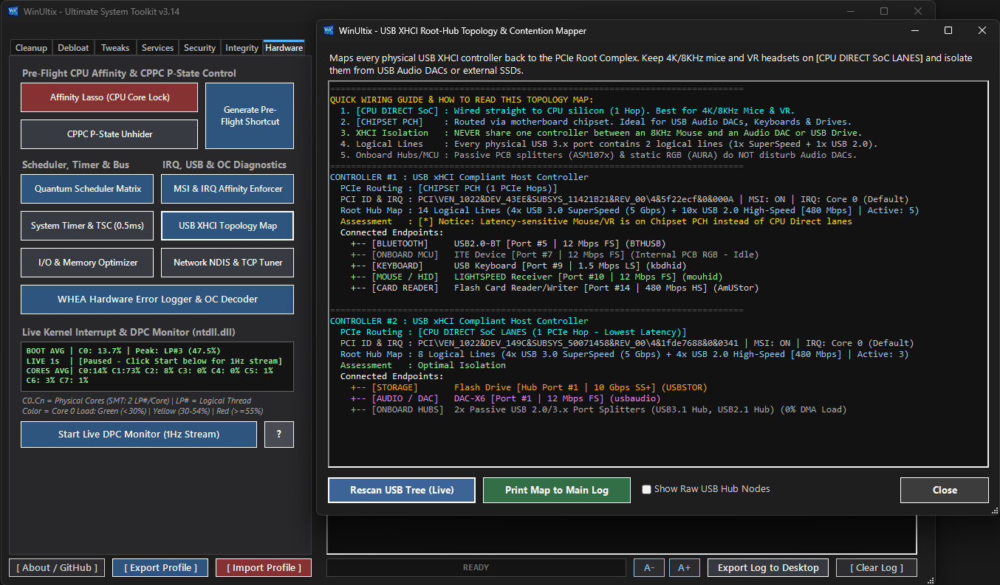
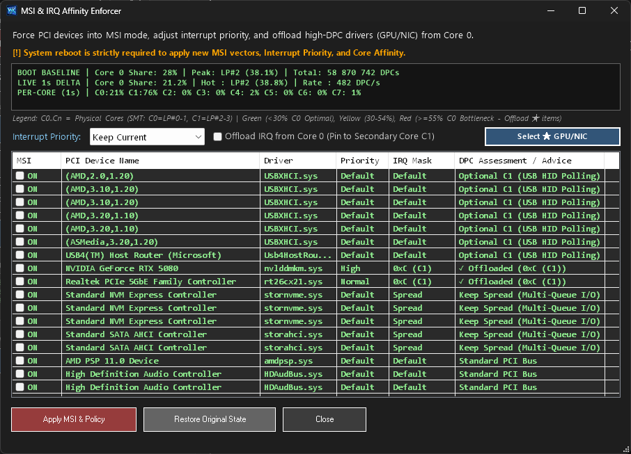
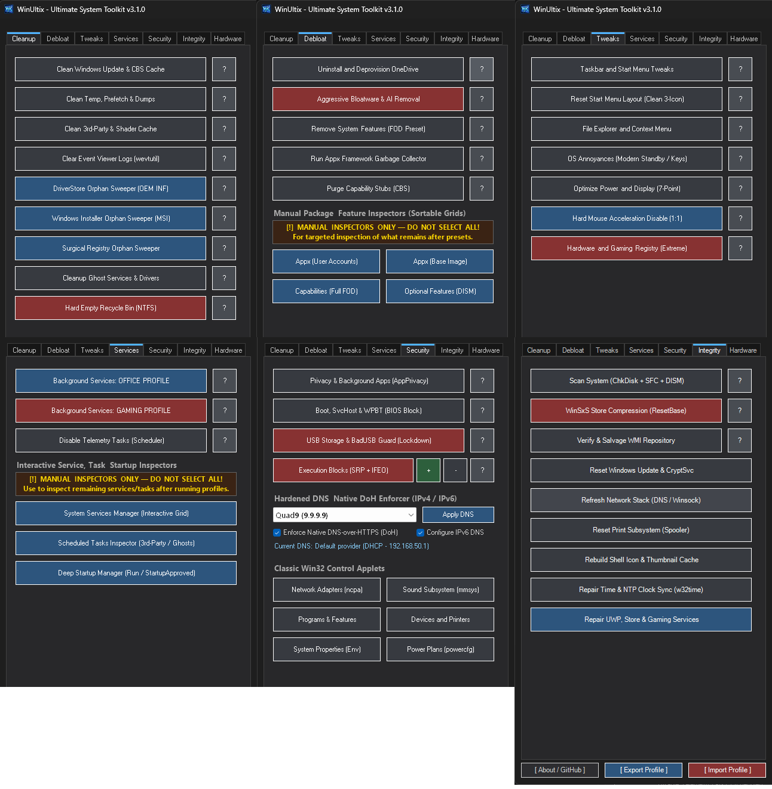
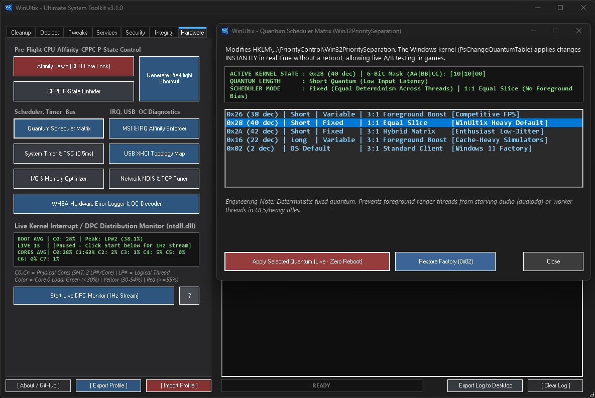

<div align="center">
  
  <h1>WinUltix 3.14</h1>
  <p><b>The Ultimate ~600KB Zero-WMI Windows 11 & 10 Hardware Tuner, Debloater, and System First-Aid Toolkit</b></p>
</div>

> 🔗 **Part of the Ultix Ecosystem:**
> Looking for a clean, pre-debloated Windows 11 ISO deployment? Check out **[AutoUltixed](https://github.com/Firever-ultix/AutoUltixed)**.
> Looking for live post-install hardware, kernel & OS tuning? You are at **[WinUltix](https://github.com/Firever-ultix/WinUltix)**.

Most Windows utilities force a bad compromise: they are either bloated 150 MB background apps that eat your RAM, or reckless "black-box" scripts that blindly delete system files, break Windows Update, and ruin your Xbox/Steam logins.

I built **WinUltix** to be the exact opposite: **a fast, 100% transparent, zero-dependency, Zero-WMI engineering toolkit (~600 KB)** for Windows 11 (25H2 / 26H2) and Windows 10. It replaces **10 separate standalone programs** (*DriverStore Explorer, PatchCleaner, MSI Utility, Process Lasso, LatencyMon, USB Tree Viewer, TimerResolution, Autoruns, TCP Optimizer, and Debloaters*) inside one native dark interface. Every tweak is explained on hover, runs asynchronously in background Runspaces without freezing the GUI, and includes a **Symmetric Revert (Undo)** engine so you can restore factory defaults anytime.



---

### ⚡ Quick Start (Zero Download)
Launch WinUltix directly in memory from an **Administrator** PowerShell / Terminal window:
```powershell
irm https://raw.githubusercontent.com/Firever-ultix/WinUltix/main/build/WinUltix_Monolith.ps1 | iex
```

*(Prefer a standalone `.exe`? Grab the compiled executable from the **[Releases](https://github.com/Firever-ultix/WinUltix/releases)** page).*
SHA-256: AE066859C75A98743FE6CA5D5E58DA96D0248830A97976F21429101922B6DD02

---

### 🔥 Spotlight: Features You Won't Find Anywhere Else

#### 1. Break Open the Windows USB Black Box (`USB XHCI Topology & Contention Mapper`)
On modern AMD and Intel motherboards, **not all USB ports are created equal**. Some ports wire **directly into your CPU's silicon (SoC lanes)** with ultra-low latency, while others travel through **Chipset (PCH) PCIe bridges** and onboard hub splitters shared with SATA drives, RGB controllers, and Wi-Fi. Windows completely hides this physical wiring from you.

* **Instant PCIe-to-USB Hardware Tree (`<5 ms`):** Using a native `cfgmgr32.dll` kernel device-tree walker, I map every active physical `USBXHCI` and `USB4` controller back to the PCIe Root Complex and count the exact PCI bridge hops.
* **CPU Direct vs. Chipset PCH Classification:** Instantly see which USB ports run on **`[CPU DIRECT SoC LANES]`** (1 PCIe hop—ideal for 4K/8KHz gaming mice and VR headsets) and which sit behind **`[CHIPSET PCH]`** or **`[SECONDARY BRIDGE]`** controllers.
* **Live Root-Hub Line & Link-Speed Probing (`DeviceIoControl`):** Sends low-level `IOCTL_USB_GET_NODE_CONNECTION_INFORMATION_EX_V2` queries directly to `USBHUB3.sys` to reveal how many SuperSpeed (`5/10/20 Gbps`), `USB4 (40 Gbps)`, and `USB 2.0 (480 Mbps)` logical lines each controller exposes, which exact `Port #` each device is using, and its live negotiated speed (`12 Mbps FS`, `480 Mbps HS`, `5 Gbps SS`, `10/20 Gbps SS+`—even warning you if a USB 3.x drive is throttled inside a USB 2.0 port).
* **True Silicon Names & Smart Wireless/Hub De-Cluttering:** Reads real hardware descriptors (`DEVPKEY_Device_BusReportedDeviceDesc`), collapses virtual wireless pairing slots (e.g., *Logitech LIGHTSPEED*) into a single physical receiver, strips duplicate composite macro interfaces from QMK/VIA keyboards and gaming mice, and cleanly separates passive motherboard port expanders (`[ONBOARD HUBS]`), card readers (`[CARD READER]`), and static RGB controllers (`[ONBOARD MCU]`) from your active peripherals.
* **Bus Contention Alerts & Built-In Wiring Guide:** Automatically flags red **`[!] CONTENTION`** warnings if a high-polling mouse shares an XHCI ring with an Isochronous Audio DAC or bulk USB storage drive (naming the exact conflicting devices), and includes a built-in engineering guide on how to wire your setup for zero jitter.



#### 2. Eliminate Micro-Stutters, Core 0 Bottlenecks & Driver Latency Spikes (`Hardware` Tab)

By default, Windows piles your GPU, network card, and system timers onto **CPU Core 0**. When they collide, you get audio crackles, input lag, and 1% low FPS drops.

* **Live 1Hz Kernel DPC Monitor:** Watch real-time interrupt load across every physical CPU core (`C0..Cn`) and logical thread (`LP#`) via native `ntdll.dll` telemetry.
* **MSI & Core 0 IRQ Offload Enforcer + Real-Time Kernel ETW `.sys` Profiler:** Built-in replacement for both *MSI Utility v3* and *LatencyMon*. Combines a `<5 ms` native `.NET` & `CfgMgr32` PCI interrupt table (resolving true kernel binaries via `Services\...\ImagePath`) with a lock-free **Real-Time Kernel ETW ISR/DPC Driver Profiler (`[WinUltix.DpcDriverProfiler]`)**:
* **Live Per-Driver Overhead (`Avg µs/s`, `1s Load`, and `Max Peak µs`):** Tracks exact execution time in microseconds per second and single-routine latency spikes for every PCI hardware driver (`nvlddmkm.sys`, `amdkmdag.sys`, `igdkmd64.sys`, `USBXHCI.sys`, `stornvme.sys`) AND non-PCI OS kernel subsystem (`dxgkrnl.sys`, `Wdf01000.sys`, `ntoskrnl.exe`, `tcpip.sys`, `ndis.sys`).
* **Zero-Jitter Multi-Mode Sorting:** Sort live by *Offload Advice ★*, *Cumulative Session Avg Load (`µs/s`)*, *Peak Driver Spike (`Max µs`)*, or *1s Live Load* without row jumping, and reset counters anytime via **`[ Reset Stats ]`**.
* **1-Click Core 0 Offload:** Automatically unlocks `TrustedInstaller`-protected NIC/Audio keys, switches devices to MSI mode, sets Interrupt Priority, and offloads heavy GPU/NIC interrupts from Core 0 to physical Core 1 (`0xC`)—with full backup and restore.
* **Live Quantum Scheduler Matrix (`Win32PrioritySeparation`):** Decode the kernel's 6-bit scheduler bitmask and switch between competitive presets (**`0x26`** *Short/Variable 3:1 Boost*, **`0x28`** *Short/Fixed 1:1 Deterministic*, **`0x2A`** *Short/Fixed 3:1 Hybrid*, **`0x16`** *Long/Variable*, and **`0x02`** *Factory*) **live in real time without rebooting**—perfect for A/B testing frametimes in-game.
* **0.5ms Hardware Timer + Live Test:** Unlocks global `0.5ms` timer precision in Windows 11, forces the low-latency CPU TSC clock, toggles HPET via zero-WMI `CfgMgr32` / `pnputil`, and includes a live **`Test 0.5ms Lock`** button.



#### 3. Instant `<1 ms` Zero-WMI System & Hardware Fingerprint Banner

Every launch and exported `.txt` log automatically prints a low-level hardware specification banner in under `1 ms` without touching WMI:

* **OS & Motherboard:** Exact Windows 10/11 edition, `DisplayVersion` (`24H2`/`25H2`/`26H2`), Build + UBR, and BIOS motherboard model.
* **CPU & L3 Topology:** Processor name, physical/logical core count, topology classification (*Intel Hybrid P+E, AMD 8C Single-CCD, AMD Dual-CCD X3D*), and total L3 Cache (with per-CCD domain split on asymmetric X3D chips).
* **SMBIOS Type 17 RAM Inspector & XMP/EXPO Guard:** Reads raw `RSMB` firmware tables (`kernel32!GetSystemFirmwareTable`) to display total RAM, DDR4/DDR5 generation, active memory speed (`MT/s`), module configuration (`2x 16 GB`), occupied DIMM slots (`2/4 Slots`), SPD `PartNumber`, and **automatically warns you if a BIOS reset dropped your XMP/EXPO RAM back to slow JEDEC clocks** (e.g., `[XMP/EXPO Off - Spec: 3600 CL16]`).
* **64-Bit GPU VRAM & Live PCIe Bus Link:** Queries `qwMemorySize` for true 64-bit VRAM capacity (bypassing the 4 GB 32-bit WMI limit), reads live negotiated **PCIe Link Speed & Width (`PCIe 4.0 x16` / `PCIe 5.0 x16`)** via `CfgMgr32`, and decodes WDDM strings into clean driver versions.

---

### 🧰 The 7-Tab Swiss Army Knife — Complete Feature Tour

All **64 tools** are organized into 7 thematic tabs with a clean 4-color engineering palette (**Slate** = Standard Action, **Steel Blue** = Interactive Inspector/Analyzer, **Crimson** = Aggressive/Lockdown, **Neutral Gray** = Audits):

#### 🧹 1. `Cleanup` — Disk Hygiene & Deep Orphan Sweepers (9 Tools)
Go far beyond basic temp cleaners by reclaiming every GB wasted from hidden Windows package repositories using fast, native `.NET` registry scanners:
* **DriverStore Orphan Sweeper (`oemXX.inf`):** Built-in replacement for *DriverStore Explorer*. Uses native `OpenSubKey` kernel enumeration and a locale-independent `pnputil` parser to scan `System32\DriverStore\FileRepository`, locks currently active hardware and DCH extension drivers in red (`[ACTIVE - LOCKED]`), and purges superseded NVIDIA, AMD, Intel, and Realtek driver packages.
* **Windows Installer Orphan Sweeper (`MSI/MSP`):** Built-in replacement for *PatchCleaner*. Audits `C:\Windows\Installer` and `$PatchCache$` against live `UserData` and `Uninstall` hives, reads native COM `SummaryInformation` streams to reveal real product names behind hex filenames, locks active uninstallers, and deletes orphaned `.msi`/`.msp` payloads.
* **Surgical Registry Orphan Sweeper (with Custom JSON Backup & Restore):** Zero-risk, CLI-argument-aware scanner that purges dead file references left behind by uninstalled games/apps across **Firewall Rules**, **AppCompat Store/Layers**, **DirectX GPU Preferences**, **SharedDLLs**, **MSI Folders**, and **App Paths** (while shielding unplugged USB drives). Includes interactive **`Save / Restore Backup (JSON)...`** file dialogs plus an automatic shadow backup in `%LOCALAPPDATA%\WinUltix`.
* **Ghost Services & Drivers Sweeper:** Zero-WMI scanner (`ServiceController::GetDevices`) that removes dead third-party service and kernel driver registrations pointing to missing `.exe`/`.sys` files while automatically skipping `TrustedInstaller`-locked OS stubs and unmounted external volumes.
* **Windows Update & CBS Cache Cleaner:** Safely purges `SoftwareDistribution`, Delivery Optimization, and `Logs\CBS` (automatically releasing `TiWorker.exe` file locks).
* **Temp, Prefetch & Crash Dump Cleaner:** Purges System/User Temp across all profiles (with smart `$env:TEMP` deduplication), Prefetch, WER reports, and memory dumps.
* **3rd-Party App & GPU Shader Cache Cleaner:** Clears installed multi-profile browser caches (Chrome, Edge, Brave, Vivaldi, Firefox, Opera—including modern `Network\Cache` and `Service Worker` storage), Discord/Steam/Spotify caches, and **DirectX / NVIDIA (`PerDriverVersion\DXCache`) / AMD GPU shader caches**.
* **Event Viewer Log Cleaner & Hard NTFS Recycle Bin Purge:** Asynchronously clears `.evtx` diagnostic channels via `wevtutil` and force-empties corrupted Recycle Bins across all drives.

#### 🗑️ 2. `Debloat` — Bloatware, Recall AI & Component Removal (9 Tools)
* **Uninstall & Deprovision OneDrive:** Multi-profile OneDrive amputation across all loaded `HKEY_USERS` hives—including residual `Explorer\Desktop\NameSpace` shell folders—while keeping dormant `%SystemRoot%` stubs so `sfc /scannow` stays 100% healthy.
* **Aggressive Bloatware & AI Removal (64 Targets):** High-speed, single-pass DISM deprovisioning and removal of 64 UWP bloatware apps, **Windows Recall** payloads, and **Copilot AI**—while strictly shielding 25H2/26H2 shell packages, Xbox Identity, Steam, and Microsoft Store.
* **System Features (FOD Preset) & CBS Capability Stubs:** Strip 14 unneeded Features on Demand (WordPad, Steps Recorder, Quick Assist, Fax, Hello Face) and purge underlying CBS `*stub*` packages.
* **Appx Framework Garbage Collector:** Resolves transitive dependency graphs to remove orphaned UWP runtime frameworks.
* **4 Manual Package & Feature Inspector Grids:** Sortable tables with live search for granular control over remaining **User Appx**, **Base Image Provisioned Appx**, **Full FOD Capabilities** (with red `[CRITICAL - LOCKED]` shields on DirectX, Ethernet LAN, and Defender FODs), and **Windows Optional Features (DISM)**.

#### ⚡ 3. `Tweaks` — Shell, 26H2 Start Menu, Power & Gaming Registry (7 Tools)
* **Taskbar & Start Menu Tweaks:** Align the taskbar left, show clock seconds, kill Bing web search, and disable Widgets (includes a symmetric kernel-level bypass for Microsoft's **`UCPD.sys`** protection driver on Windows 11 24H2/25H2/26H2).
* **1-Click Clean Start Menu (3-Icon + Classic List):** Wipes promotional Start Menu tiles (`start2.bin`), hides recently opened file shortcuts, forces the **Classic Alphabetical All-Apps List (`AllAppsViewMode=2`)** instead of Windows 11 26H2 category tiles, and compiles a clean 3-icon Start Menu (*Edge, Settings, Explorer*) with zero MDM locks left behind.
* **File Explorer & Classic Context Menu:** Restore the classic Windows 10 right-click menu, show file extensions, unpin OneDrive, and run Explorer windows in separate processes.
* **OS Annoyances:** Disable Modern Standby S0 (restore hardware S3 sleep), block AutoPlay, and kill Sticky/Filter Keys popups.
* **7-Point Power & Display Optimizer:** Disable Hibernation (`hiberfil.sys`), stop SATA HDD spin-down lag, disable **USB Selective Suspend** (prevents drops on USB DACs and 8KHz mice), disable plan PCIe ASPM, and turn off **Content Adaptive Brightness (CABC)** to stop auto-dimming on OLED/IPS monitors.
* **Live 1:1 Raw Mouse Input & Extreme Gaming Registry:** Zero out mouse acceleration curves **live in real time via `user32!SystemParametersInfoW` (`SPI_SETMOUSE`) without logging out**, disable GameDVR, enable HAGS & Flip Model, disable Multiplane Overlay (**MPO**—fixes VRR/G-Sync OLED flicker), uncap MMCSS `NetworkThrottlingIndex`, and tune VBS/HVCI while preserving your custom `Win32PrioritySeparation` Quantum Scheduler preset.

#### ⚙️ 4. `Services` — Background Profiles & Interactive Managers (6 Tools)
* **Office (Light) & Gaming (Heavy) Service Profiles:** Symmetrically disable **12 (Office)** or up to **60 (Gaming)** background services—including `SysMain`, `WSearch`, `Spooler`, `GameInputSvc`, disk-thrashing `DPS`/SRUM logging, and Per-User UWP sync templates (`CDPUserSvc`, `OneSyncSvc`, `UserDataSvc`)—with 1-click revert.
* **Telemetry Scheduled Tasks Lockdown (8 Branches):** Disable Microsoft `CompatTelRunner` (*Application Experience*), CEIP, Autochk Proxy, DiskDiagnostic, Feedback, PerformanceTrace, WER, and XblGameSave task branches.
* **System Services Manager (Interactive Grid):** What `services.msc` should have been—a zero-lag dark sortable table with instant search, `Automatic (Delayed)` detection, Per-User `_LUID` template syncing, and red safety locks (`[CRITICAL - LOCKED]`) on core boot/RPC/Defender services.
* **Scheduled Tasks Inspector & Deep Startup Manager:** Expose 3rd-party updaters and broken **`[GHOST / Missing Exe]`** tasks (with `WorkingDirectory`, unplugged-drive, and `TaskCache` DACL write-permission filtering so `TrustedInstaller`-locked OS tasks are never flagged), and audit every `Run`, `RunOnce`, GPO, and Startup folder entry across all loaded user profiles while decoding Task Manager's binary `StartupApproved` states.

#### 🛡️ 5. `Security` — Privacy, USB/MTP Guard, Kernel Locks & Encrypted DNS (13 Tools)
* **4-Layer USB Storage, WPD/MTP & BadUSB Perimeter Guard:** Symmetrically lock down your USB ports and MTP connections with selectable, cross-aware layers:
1. **USB & MTP Read-Only Guard:** Block writing to USB pendrives (`WriteProtect = 1`) and MTP smartphones (`WPD Deny_Write`) to prevent data leaks or ransomware infection while allowing file reads.
2. **USB Execution Guard:** Block launching `.exe` payloads from removable drives.
3. **USB Total Blackout:** Disable both **`USBSTOR`** and modern **`UASPStor`** (USB NVMe enclosure) kernel drivers alongside full WPD/Removable read/write blocks.
4. **Anti-BadUSB & DMA Lock-Screen Guard:** Block new USB/PCIe/Thunderbolt device enumeration while the screen is locked (`Win+L`).
* **Privacy & UWP AppPrivacy (52 Rules):** Block OS telemetry, lock 28 background UWP permissions (Camera, Mic, Location), and stop silent app installations (`ContentDeliveryManager`).
* **Boot, SvcHost & UEFI WPBT Block:** Block motherboard BIOS/UEFI binary injection (`DisableWpbtExecution`), disable Fast Startup kernel bugs, block RDP, and consolidate `SvcHost` processes via native `GlobalMemoryStatusEx` RAM detection.
* **Dual-Layer Execution Blocks (`SRP + IFEO`):** Permanently block telemetry executables (`CompatTelRunner.exe`, `Widgets.exe`, `MicrosoftEdgeUpdate.exe`) or add your own custom `.exe` targets (`+` / `-` with built-in OS binary safety guard and automatic rule unlocking) using both Safer API policies and Kernel Image File Execution Options.
* **Hardened DNS & Native DoH Enforcer + 8 Classic Win32 Applets:** Apply Quad9, Cloudflare, AdGuard, Google, or OpenDNS across IPv4 & IPv6 in `<2 ms` via zero-WMI `.NET` adapter discovery with native Windows 11 **DNS-over-HTTPS (DoH)** encryption, plus 1-click access to `ncpa.cpl`, `mmsys.cpl`, `appwiz.cpl`, `Devices & Printers`, `SystemPropertiesAdvanced`, `powercfg.cpl`, `gpedit.msc / regedit`, and `compmgmt.msc`.

#### 🚑 6. `Integrity` — 1-Click System First-Aid & OS Repair (9 Tools)
When Windows breaks, fix the exact subsystem without reinstalling the OS:
* **Scan & Repair System (`ChkDisk + DISM + SFC`) + Fast `<3s` Health Audit:** Automated maintenance console that repairs filesystem errors, restores corrupted component store payloads, and verifies system files, paired with an instant `DISM /CheckHealth` and zero-WMI `fsutil` NTFS dirty-bit auditor.
* **WinSxS Component Store Compression (`DISM /ResetBase`):** Safely compresses superseded Windows Update backup layers to reclaim 5–15 GB of SSD space (with real-time progress streaming and pending-reboot protection).
* **Verify & Salvage WMI Repository:** Repairs broken system monitoring and hardware queries via `winmgmt /salvagerepository` and `wmiadap /f`.
* **Reset Windows Update & Cryptographic Subsystem:** Fixes stuck updates by stopping `wuauserv`/`bits`/`cryptSvc`, purging corrupted `qmgr*.dat` queues, flushing `catroot2` & `DataStore`, and batch re-registering 21 core COM DLLs in a single pass.
* **Refresh Network Stack:** Flushes DNS, clears ARP routing tables, resets WinHTTP proxy, resets the Winsock catalog, and resets the TCP/IPv4 & IPv6 stack.
* **Reset Print Subsystem (Spooler First-Aid):** Auto-unlocks `Spooler` if disabled by the Gaming profile, terminates deadlocked `spoolsv.exe`, deletes `.SHD`/`.SPL` queue files, and restarts `PrintWorkflowUserSvc` & `Spooler`.
* **Rebuild Shell Icon & Thumbnail Cache:** Gracefully cycles Explorer, deletes corrupted `iconcache_*.db` / `thumbcache_*.db` databases, and forces a clean rebuild via `ie4uinit.exe`.
* **Repair Time & NTP Clock Sync (`w32time`):** Enforces a UTC hardware RTC clock (`RealTimeIsUniversal=1` to eliminate dual-boot clock drift), re-registers `W32Time`, configures resilient Cloudflare/NTP.org peers, and forces an immediate resync to fix broken TLS/DoH/Xbox authentication.
* **Repair UWP, Store & Xbox Gaming Services:** Unlocks `AppXSvc`, `ClipSVC`, and `GamingServices`, flushes `WindowsStore` cache (`wsreset -i`), and re-registers existing Shell, Store, and Xbox `AppxManifest.xml` files without restoring removed bloatware.




#### 🔧 7. `Hardware` — Low-Level Silicon, Bus & Overclocking Cockpit (11 Tools)
* **Topology-Aware Affinity Lasso:** Automatically detects **AMD 3D V-Cache** (7800X3D, 9800X3D, 7950X3D, 9950X3D) and **Intel Hybrid P+E** CPUs, resolving process paths in `<15 ms` via native `QueryFullProcessImageNameW` and locking background apps (Discord, Spotify, Browsers) to secondary cores or E-Cores so prime gaming cores stay 100% free.
* **CPPC P-State Unhider & Dead Man's Switch:** Unlocks hidden CPU power controls (`EPP`, `Idle Demote/Promote`) and arms a `SYSTEM` scheduled task failsafe that automatically restores factory settings on the next boot if an aggressive undervolt crashes.
* **Desktop Pre-Flight Game Mode Shortcut:** Generates a self-contained, DPI-aware dark desktop toggle to arm or disarm CPU Affinity and Max CPPC rules right before launching a game.
* **I/O & Memory Latency Optimizer:** Disables PCIe ASPM (`DisableASPM=1`), NVMe APST (`IdlePowerMode=0` in `stornvme.sys`) to eliminate SSD wake-up stutters, and disables RAM compression (`MMAgent`).
* **Network NDIS & TCP Tuner:** Symmetrically tunes physical NIC driver properties (Interrupt Moderation, Flow Control, EEE/Green Ethernet, RSS/RSC/LSO) and enforces `TCPNoDelay` / `TcpAckFrequency = 1`.
* **WHEA Hardware Error Logger & OC Decoder:** Translates cryptic `Microsoft-Windows-WHEA-Logger` `APIC IDs` into **physical CPU core numbers** via hardware core bitmasks—accurately pinpointing unstable Curve Optimizer cores (ID 18), FCLK/SoC errors (ID 19), or tight DDR4/DDR5 memory timings (ID 47) across both AMD and Intel Hybrid CPUs.



* **💾 Asynchronous Portable JSON Profiles:**
Configuring a new PC or helping a friend? Click **`[ Export Profile ]`** in the footer to save your active registry tweaks, exact `Win32PrioritySeparation` quantum value, Power & Display settings, USB Perimeter locks, SRP rules, service states, and Affinity Lasso roster into a portable `.json` file, and enforce them on any machine via **`[ Import Profile ]`**.

---

### 🛡️ Antivirus Detections & Transparency (False Positives)

Because WinUltix modifies low-level kernel registry keys, adjusts hardware power states, and disables OS telemetry services, some heuristic antivirus scanners may flag the compiled `.exe`:

* **Why?** The standalone executable is unsigned and requests Administrator privileges to configure hardware and system services.
* **100% Open Source:** Every single line of code is readable right here in the repository. You can audit the `/Modules` folder yourself, run the raw PowerShell script directly in memory (`irm ... | iex`), or compile your own `.exe` from source using `Compile-WinUltix.ps1`.

---

### ⚖️ License & Disclaimer

* Licensed under the **MIT License**.
* *Provided "AS IS". While WinUltix is engineered with strict safety checks, critical service/driver locks, and a symmetric Revert engine, low-level OS and hardware tuning always carries inherent risk. Creating a System Restore Point before applying heavy modifications is recommended.*

### ☕ Support the Project

WinUltix is—and will always be—100% free, open-source, and ad-free. If this toolkit saved you time, fixed a stubborn Windows bug, mapped your USB ports, or smoothed out your frametimes, you can buy me a coffee:

👉 **[https://buymeacoffee.com/firever](https://buymeacoffee.com/firever)**

Thank you!